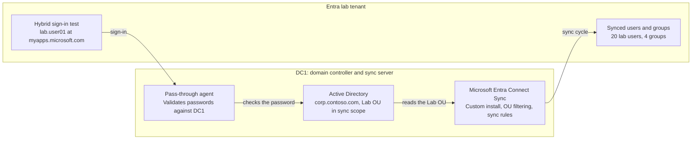

Hybrid Identity with Microsoft Entra Connect

Sync a small test Active Directory forest to a dedicated Microsoft Entra lab tenant with Microsoft Entra Connect Sync, then prove it worked from both sides. This is a refreshed version of Microsoft's optional SC-300 [Lab 07](https://microsoftlearning.github.io/SC-300-Identity-and-Access-Administrator/Instructions/Labs/Lab_07_AddHybridIdentityWithAzureADConnect.html), which estimates at least 1 hour plus 30 to 60 minutes of VM deployment time.

> [!WARNING]
> Run this in a dedicated lab tenant, never in a production tenant. Entra Connect writes users and groups into whatever tenant the wizard signs in to.

Checked against Microsoft documentation in November 2026. Microsoft Entra Connect Sync 2.6.92.0 was the latest build at that time.

## Contents

- [Overview](#overview)
- [Before you start](#before-you-start)
- [Part A: Prepare the Entra tenant](#part-a-prepare-the-entra-tenant)
- [Part B: Build the on-prem AD](#part-b-build-the-on-prem-ad)
- [Part C: Install Entra Connect Sync](#part-c-install-entra-connect-sync)
- [Part D: Verify the sync](#part-d-verify-the-sync)
- [Part E: Optional extensions](#part-e-optional-extensions)
- [Troubleshooting and cleanup](#troubleshooting-and-cleanup)
- [Sources](#sources)

## Overview

**You end up with**

- A test forest, `corp.contoso.com`, with 20 department users in four groups, plus four decoy users that sync should leave out
- Entra Connect Sync installed with custom settings: pass-through authentication, Seamless SSO and OU filtering
- A cloud-only Hybrid Identity Administrator account that runs the wizard
- Evidence it works: synced users in the Entra admin center, sync status, and a delta cycle you triggered yourself



Entra Connect on `DC1` reads the Lab OU and sends users and groups to the tenant. A sign-in with an on-prem password is checked by the pass-through agent against AD.

| Part | Where | What you do |
| --- | --- | --- |
| A. Prepare the Entra tenant | Entra admin center | Create the sync account and record a baseline |
| B. Build the on-prem AD | Windows Server VM, PowerShell | Forest, OUs, groups and test users |
| C. Install Entra Connect Sync | Same VM | Custom install with pass-through auth, Seamless SSO and OU filtering |
| D. Verify the sync | VM and Entra admin center | Check status, users, groups and a hybrid sign-in |
| E. Optional extensions | VM | Attribute-level filtering rules, Entra hybrid join |
| F. Troubleshooting and cleanup | VM and Entra admin center | Fix common problems, then tear down |

## Before you start

| Item | Requirement |
| --- | --- |
| Entra tenant | A disposable lab tenant. Production would use a verified custom domain; in a lab you can use the default `YOURTENANT.onmicrosoft.com` as the UPN suffix |
| Entra role for the wizard | Hybrid Identity Administrator or Global Administrator, assigned directly to a work or school account (not through a group, not a Microsoft account) |
| Active Directory | Forest functional level and schema at Windows Server 2003 or later; a writable DC (no RODC); no dotted NetBIOS name |
| Sync server | Domain-joined Windows Server with the full GUI (no Server Core); 2022 or 2025 recommended. Under 50,000 objects: 1.6 GHz CPU, 6 GB RAM, 70 GB disk |
| Software | .NET Framework 4.7.2 or later, TLS 1.2 enabled, PowerShell 5.0 or later |
| Entra Connect Sync build | 2.6.84.0 is the minimum. The latest listed is 2.6.92.0 (September 23, 2026), a hotfix that resolves a pass-through authentication registration failure in 2.6.91.0, so install the newest build. The installer is only available from the Entra admin center |
| On-prem account | Enterprise Administrator for express settings; this lab uses the forest's built-in Administrator |
| Network | Server resolves AD and Entra endpoints; outbound access to Entra and Microsoft 365 endpoints, with no TLS inspection between Connect and Entra |

Source: [Microsoft Entra Connect Sync: Prerequisites](https://learn.microsoft.com/en-us/entra/identity/hybrid/connect/how-to-connect-install-prerequisites).

**What differs from Microsoft's Lab 07**

- The wizard is now called Microsoft Entra Connect, and the MSI comes only from the Entra admin center.
- A dedicated Hybrid Identity Administrator replaces the lab's Global Administrator `john.doe`.
- A plain Windows Server 2022 VM replaces the TLG 3-VM template and its Server 2016; Microsoft notes DCs on 2016 or older may need a paid support program.
- Builds before 2.6.84.0, or servers without application-based authentication, stop syncing after April 7, 2027. New installs configure it during setup.
- A self-contained PowerShell script builds the test users, so there is no download of the CreateDemoUsers script and no 2,500-user run.
- The lab's UAC and IE security downgrades are skipped.

## Part A: Prepare the Entra tenant

Part A creates the one cloud account the wizard needs and records a baseline in the [Entra admin center](https://entra.microsoft.com).

1. **Confirm the tenant.** Open Overview and note the tenant name, tenant ID and primary domain (`YOURTENANT.onmicrosoft.com`). Make sure this is the lab tenant.
2. **Record a baseline.** Open Entra Connect, then Connect Sync, and note that no sync has run yet. Count the users already in the tenant.
3. **Choose the UPN suffix for the lab users.** Lab shortcut: use `YOURTENANT.onmicrosoft.com`. Alternative: add and verify a custom domain under Domain names (this needs a DNS TXT record) and use that instead.
4. **Create the sync account.** Go to Users, New user, Create new user. Set the user principal name to `lab.sync@YOURTENANT.onmicrosoft.com`, the display name to `Lab Sync Admin`, and let Entra generate the password. On the Assignments tab choose Add role, then Hybrid Identity Administrator.
5. **Do its first sign-in.** In a private window sign in as `lab.sync`, change the password, and register MFA if prompted, so the wizard sign-in in Part C does not stall.
6. **Check the role.** Under Roles and administrators, open Hybrid Identity Administrator and confirm `lab.sync` appears as a direct assignment, not through a group.

**Expected result:** one new cloud-only user holding Hybrid Identity Administrator, and a note of the tenant ID, primary domain and chosen UPN suffix.

## Part B: Build the on-prem AD

Part B turns one Windows Server 2022 VM into the `corp.contoso.com` forest with test users. Run every script in an elevated PowerShell session on `DC1`.

### B1. Create the VM

Create a Windows Server 2022 VM with Desktop Experience named `DC1`: 2 vCPU, 8 GB RAM, 80 GB disk, static IP. In Azure, `Standard_D2s_v5` is the size Microsoft's lab uses. One VM is both domain controller and sync server here; in production the sync server is a separate domain-joined member server and a Tier 0 asset.

### B2. Promote it to a domain controller

```powershell
Install-WindowsFeature AD-Domain-Services -IncludeManagementTools
Install-ADDSForest -DomainName "corp.contoso.com" -DomainNetbiosName "CORP" -InstallDns `
    -SafeModeAdministratorPassword (Read-Host "DSRM password" -AsSecureString)
```

The server restarts. Sign back in with the VM's admin account in domain form: `CORP\Administrator`, or `CORP\` plus the admin name you gave the VM. If one is refused, try the other.

### B3. Enable strong TLS for .NET and set the execution policy

```powershell
foreach ($v in 'v4.0.30319','v2.0.50727') {
  foreach ($root in 'HKLM:\SOFTWARE\Microsoft\.NETFramework','HKLM:\SOFTWARE\WOW6432Node\Microsoft\.NETFramework') {
    $p = "$root\$v"
    if (-not (Test-Path $p)) { New-Item -Path $p | Out-Null }
    New-ItemProperty -Path $p -Name SystemDefaultTlsVersions -Value 1 -PropertyType DWord -Force | Out-Null
    New-ItemProperty -Path $p -Name SchUseStrongCrypto -Value 1 -PropertyType DWord -Force | Out-Null
  }
}
Set-ExecutionPolicy RemoteSigned -Scope LocalMachine -Force
```

Restart the server afterward. The Connect installer fails if TLS 1.2 is not enabled, and it runs signed scripts, so Microsoft recommends `RemoteSigned`.

### B4. Turn on the AD Recycle Bin

Microsoft recommends it.

```powershell
Enable-ADOptionalFeature 'Recycle Bin Feature' -Scope ForestOrConfigurationSet -Target 'corp.contoso.com' -Confirm:$false
```

### B5. Add the UPN suffix

```powershell
$UpnSuffix = "YOURTENANT.onmicrosoft.com"   # or your verified custom domain from Part A
Get-ADForest | Set-ADForest -UPNSuffixes @{Add = $UpnSuffix}
```

### B6. Create OUs, groups and users

The script prompts once for the password all lab users share. It builds 20 users that should sync, 2 users in an OU that sync will skip, and 2 users whose UPN suffix will not match your tenant (used in Part E).

```powershell
Import-Module ActiveDirectory
$UpnSuffix = "YOURTENANT.onmicrosoft.com"   # same value as B5
$base = (Get-ADDomain).DistinguishedName
$lab  = "OU=Lab,$base"
$pw   = Read-Host "Initial password for lab users" -AsSecureString

New-ADOrganizationalUnit -Name "Lab" -Path $base -ProtectedFromAccidentalDeletion $false
"Users","Groups","Servers","Excluded" | ForEach-Object {
    New-ADOrganizationalUnit -Name $_ -Path $lab -ProtectedFromAccidentalDeletion $false
}

$depts = "Engineering","Finance","HR","Sales"
foreach ($d in $depts) {
    New-ADGroup -Name "GG-$d" -GroupScope Global -GroupCategory Security -Path "OU=Groups,$lab"
}

# 20 users that should sync
1..20 | ForEach-Object {
    $n    = '{0:D2}' -f $_
    $dept = $depts[$_ % 4]
    $sam  = "lab.user$n"
    New-ADUser -Name "Lab User $n" -GivenName "Lab" -Surname "User$n" -SamAccountName $sam `
        -UserPrincipalName "$sam@$UpnSuffix" -Department $dept -Path "OU=Users,$lab" `
        -AccountPassword $pw -Enabled $true
    Add-ADGroupMember -Identity "GG-$dept" -Members $sam
}

# 2 users in an OU that Part C filters out
1..2 | ForEach-Object {
    $sam = "excluded.user{0:D2}" -f $_
    New-ADUser -Name $sam -SamAccountName $sam -UserPrincipalName "$sam@$UpnSuffix" `
        -Path "OU=Excluded,$lab" -AccountPassword $pw -Enabled $true
}

# 2 users whose UPN suffix does not match the tenant (Part E)
1..2 | ForEach-Object {
    $sam = "legacy.user{0:D2}" -f $_
    New-ADUser -Name $sam -SamAccountName $sam -UserPrincipalName "$sam@corp.contoso.com" `
        -Path "OU=Users,$lab" -AccountPassword $pw -Enabled $true
}
```

**Check:** this should return a count of 24 (20 + 2 + 2).

```powershell
(Get-ADUser -Filter * -SearchBase "OU=Lab,$((Get-ADDomain).DistinguishedName)" | Measure-Object).Count
```

Optional: run [IdFix](https://github.com/Microsoft/idfix) first. Microsoft recommends it before any sync to catch duplicates and formatting errors.

## Part C: Install Entra Connect Sync

Part C installs Microsoft Entra Connect Sync on `DC1` with custom settings, which lets you pick pass-through authentication and choose which OUs sync; express settings deploy password hash synchronization instead.

### C1. Download the installer on DC1

Sign in to `DC1` as the domain admin. In Edge open the [Entra admin center](https://entra.microsoft.com) and sign in as `lab.sync@YOURTENANT.onmicrosoft.com`. Go to Entra Connect, Get started, Connect Sync, and select Download. Microsoft's docs say the MSI is only available from the Entra admin center, under Manage on the Entra Connect Get started page, and menu names can shift.

If the wizard's sign-in window is blocked or blank, add `https://secure.aadcdn.microsoftonline-p.com` to Trusted sites (Microsoft lists it as required when admins use MFA), or switch IE Enhanced Security Configuration off for Administrators in Server Manager (lab only).

### C2. Run the wizard

| Wizard page | Choose |
| --- | --- |
| Welcome | Accept the license terms, then Continue |
| Express settings | Customize |
| Install required components | Leave the optional boxes unchecked, then Install (this installs SQL Server Express LocalDB by default) |
| User sign-in | Pass-through authentication, and tick Enable single sign-on |
| Connect to Microsoft Entra ID | Sign in as `lab.sync@YOURTENANT.onmicrosoft.com` and complete any MFA prompt |
| Connect your directories | Select the `corp.contoso.com` forest, Add Directory, keep Create new AD account, and enter `CORP\Administrator` with its password |
| Microsoft Entra sign-in configuration | Confirm your UPN suffix shows Verified and `userPrincipalName` is selected. Tick Continue without matching all UPN suffixes to verified domains: `corp.contoso.com` is unverified, which the two `legacy.user` accounts trigger |
| Domain and OU filtering | Sync selected domains and OUs; tick `Lab`, untick `Excluded` |
| Uniquely identifying your users, Filter users and devices, Optional features | Accept the defaults |
| Enable single sign-on | Enter credentials for `CORP\Administrator` |
| Ready to configure | Leave Start the synchronization process when configuration completes ticked, then Install |
| Configuration complete | Exit |

### C3. Confirm the build and the authentication method

In Programs and Features, check that the installed version matches the build you downloaded (2.6.92.0 at the time of writing; 2.6.84.0 is the minimum). Then reopen the wizard, choose View or export current configuration, and confirm an application (client) ID is listed: that means application-based authentication is in use. If setup stops with an error saying it could not configure application-based authentication, fix the cause and rerun it; the current wizard no longer falls back to the legacy sync account.

**Expected result:** the wizard finishes without errors, the first sync cycle starts on its own, and a new `AZUREADSSOACC` computer account appears in the domain.

## Part D: Verify the sync

Sync worked if the 20 lab users and 4 groups appear in Entra as synced objects and the Connect status indicators match the table below.

### D1. On DC1

```powershell
Import-Module ADSync
Get-ADSyncScheduler
Start-ADSyncSyncCycle -PolicyType Delta
```

Expect `SyncCycleEnabled` to be True and the delta cycle to report `Success`. If it says a cycle is already running, wait a minute and rerun.

### D2. In the Entra admin center

| Where | Expected |
| --- | --- |
| Users, All users | `lab.user01` to `lab.user20` with On-premises sync enabled = Yes; no `excluded.user` accounts; the two `legacy.user` accounts present with a `YOURTENANT.onmicrosoft.com` UPN until Part E |
| Groups, All groups | `GG-Engineering`, `GG-Finance`, `GG-HR` and `GG-Sales`, sourced from Windows Server AD, five members each |
| Entra Connect, Connect Sync | Sync status Enabled, with a recent last-sync time |
| Same page | Password hash sync Disabled; Federation Disabled; Seamless single sign-on Enabled for 1 domain; Pass-through authentication Enabled with 1 agent |

The status values match what Microsoft's Lab 07 expects for this sign-in configuration. In production you would add more pass-through agents for redundancy.

### D3. Test a hybrid sign-in

In a private window open `https://myapps.microsoft.com` and sign in as `lab.user01@YOURTENANT.onmicrosoft.com` (or your custom suffix) with the AD password you set in B6. Success means pass-through authentication validated the password against `DC1`. Entra ID, Monitoring, Sign-in logs shows the event. Tenant policy such as security defaults may ask for MFA registration first.

**Expected result:** all four rows above match, and the sign-in succeeds with an on-prem password.

## Part E: Optional extensions

Both extensions are optional: E1 uses attribute-level filtering to remove the two `legacy.user` accounts, and E2 hybrid-joins a second server.

### E1. Attribute-level filtering (sync rules)

Goal: sync only users whose UPN ends with your tenant suffix. Positive filtering needs two inbound rules: one that includes the target scope and a catch-all that excludes everything else. On `DC1` open Synchronization Rules Editor from the Microsoft Entra Connect Start menu group, keep Inbound selected, and add both rules.

| Field | Rule 1 | Rule 2 |
| --- | --- | --- |
| Name | `Custom In from AD - UPN Filter` | `Custom In from AD - Catch-all Filter` |
| Connected system | `corp.contoso.com` | `corp.contoso.com` |
| Object type, metaverse type | user, person | user, person |
| Link type | Join | Join |
| Precedence | 50 | 51 |
| Scoping filter | `userPrincipalName` ENDSWITH `@YOURTENANT.onmicrosoft.com` (your suffix) | none |
| Transformation | Constant, target `cloudFiltered`, value False | Constant, target `cloudFiltered`, value True |

A lower precedence number wins, so matching users get `cloudFiltered` = False and sync, while everyone else gets True and is filtered out. Microsoft's lab uses 50 and 51 so the rules outrank the built-in ones. Accept the warning that a full import and sync is needed, then run:

```powershell
Start-ADSyncSyncCycle -PolicyType Initial
```

**Expected result:** the two `legacy.user` accounts leave the Entra user list (they move to Deleted users) and the 20 lab users stay.

### E2. Microsoft Entra hybrid join

Prerequisite: a second Windows Server VM, `APP1`, joined to `corp.contoso.com`, with its computer account in `OU=Servers,OU=Lab`. Because that OU is under `Lab`, it is already in sync scope.

1. On `DC1` run the Entra Connect wizard again, choose Configure, then Configure device options, and sign in as `lab.sync`. Pick the hybrid join option (older builds call it Hybrid Azure AD join).
2. On Device operating system, tick Windows 10 or later domain-joined devices. Down-level devices also need Seamless SSO, which Part C already enabled.
3. On SCP configuration, tick the `corp.contoso.com` forest, set Authentication Service to Microsoft Entra ID, select Add, and enter `CORP\Administrator` when prompted. Then Next and Configure.
4. Sign in to `APP1` as `CORP\Administrator` and run:

```powershell
Enable-ScheduledTask -TaskPath "\Microsoft\Windows\Workplace Join\" -TaskName "Automatic-Device-Join"
Start-ScheduledTask  -TaskPath "\Microsoft\Windows\Workplace Join\" -TaskName "Automatic-Device-Join"
```

5. On `DC1` run `Start-ADSyncSyncCycle -PolicyType Delta`.
6. On `APP1` run `dsregcmd /status`.

**Expected result:** `dsregcmd` shows `AzureAdJoined : YES` and `DomainJoined : YES` with domain `CORP`, and Entra ID, Devices, All devices lists `APP1` with Join type hybrid joined (it can take a while to appear). In this lab, `AzureAdPrt` under User State is not expected to be YES.

## Troubleshooting and cleanup

| Symptom | Likely cause and fix |
| --- | --- |
| Wizard rejects the Entra sign-in | The role came through a group, is eligible but not activated, or the account is a Microsoft account. Assign Hybrid Identity Administrator directly to a work or school account. |
| Installer fails early | TLS 1.2 is not enabled for .NET. Rerun B3 and restart. |
| Pass-through agent will not register | Build 2.6.91.0 had a registration failure. Install 2.6.92.0 or later. |
| Users missing from Entra | Check Domain and OU filtering (`Lab` ticked, `Excluded` unticked), run a delta cycle, then look for errors in Synchronization Service Manager. |
| A user shows an unexpected `.onmicrosoft.com` UPN | Their AD UPN suffix is not verified in the tenant, or it was not added in B5. |
| Wizard will not open | A sync cycle is running. Wait for it to finish. |
| Existing server must move to application-based authentication | Run the wizard, then Additional tasks, then Configure application-based authentication to Microsoft Entra ID. |

### Clean up

**1. Stop the scheduler** on `DC1`:

```powershell
Set-ADSyncScheduler -SyncCycleEnabled $false
```

**2. Remove Seamless SSO and uninstall Entra Connect.** Rerun the wizard, choose Change user sign-in, and untick Enable single sign-on. Confirm the `AZUREADSSOACC` computer account is gone from AD (delete it if not), then uninstall Microsoft Entra Connect.

**3. Turn off directory sync in the tenant.** Connect as a Hybrid Identity Administrator:

```powershell
Install-Module Microsoft.Graph -Force
Connect-MgGraph -Scopes "Organization.ReadWrite.All,Directory.ReadWrite.All"
$organizationId = (Get-MgOrganization).Id
Update-MgOrganization -OrganizationId $organizationId -BodyParameter @{ onPremisesSyncEnabled = $false }
Get-MgOrganization | Select OnPremisesSyncEnabled
```

This converts synced users and groups to cloud-only and clears their on-premises properties. Microsoft says you must wait 72 hours before turning sync back on, and advises uninstalling the sync client first and not using this as a troubleshooting step.

**4. Delete the lab.** Remove `lab.sync`, the VMs (or their resource group), and the lab tenant if it was disposable.

## Sources

- [Lab 07: OPTIONAL — Add Hybrid Identity with Microsoft Entra Connect](https://microsoftlearning.github.io/SC-300-Identity-and-Access-Administrator/Instructions/Labs/Lab_07_AddHybridIdentityWithAzureADConnect.html): base exercise flow, wizard choices, expected status values
- [Microsoft Entra Connect Sync: Prerequisites](https://learn.microsoft.com/en-us/entra/identity/hybrid/connect/how-to-connect-install-prerequisites): requirements, roles, the April 7, 2027 deadline
- [Microsoft Entra Connect: Version release history](https://learn.microsoft.com/en-us/entra/identity/hybrid/connect/reference-connect-version-history): latest build and application-based authentication behavior
- [Application-based authentication for Microsoft Entra Connect Sync](https://learn.microsoft.com/en-us/entra/identity/hybrid/connect/authenticate-application-id): wizard menu names for viewing and switching
- [Turn off directory synchronization for Microsoft 365](https://learn.microsoft.com/en-us/microsoft-365/enterprise/turn-off-directory-synchronization): cleanup commands and caveats
